# Flutter Network Viewer

Ứng dụng desktop viết bằng Rust để xem HTTP request/response, đọc log Flutter và định dạng JSON trong cùng một cửa sổ. Không cần thêm thư viện vào ứng dụng Flutter đang theo dõi.

Các GIF bên dưới dùng dữ liệu demo. Viền đỏ đánh dấu vị trí thao tác.

## Cài đặt

Xem [GitHub Releases](https://github.com/DevMobileAn27/flutter_network_viewer/releases) và chọn gói có tên bắt đầu bằng `flutter-network-viewer-rust-`:

| Máy của bạn | Gói tải xuống |
| --- | --- |
| macOS chip Apple (M-series) | `*-macos-arm64.zip` |
| macOS chip Intel | `*-macos-x86_64.zip` |
| Windows x64 | `*-windows-x64-setup.exe` hoặc `*-windows-x64.zip` để dùng bản portable |

Nếu Releases chưa có gói Rust, mở một lượt chạy thành công trong [GitHub Actions](https://github.com/DevMobileAn27/flutter_network_viewer/actions/workflows/checks.yml) và tải **Artifacts** có tên `rust-preview-<version>-<platform>`. Giải nén artifact để lấy gói ứng dụng bên trong. Đây là bản xem trước; nếu chưa có artifact phù hợp, xem [Chạy từ mã nguồn](#chạy-từ-mã-nguồn).

- **macOS 12 trở lên:** giải nén ZIP và kéo **Flutter Network Viewer.app** vào **Applications**.
- **Windows:** chạy installer. Nếu chọn bản portable, giải nén cả thư mục rồi mở **flutter-network-viewer.exe**; giữ các tệp đi kèm cạnh tệp thực thi.

## Kết nối ứng dụng Flutter

1. Chạy app Flutter cần theo dõi ở chế độ **debug** hoặc **profile**, chẳng hạn bằng `flutter run`.
2. Mở Viewer và bấm **Find & connect**. Nếu tìm thấy một app, Viewer sẽ kết nối tự động; nếu có nhiều app, chọn app bạn muốn theo dõi.
3. Thử gọi API hoặc ghi log mới trong app Flutter, rồi mở **Network** hoặc **Console**.

Nếu Viewer không tìm thấy app, bấm **Manual URL**, dán **Flutter DevTools URL** hoặc **Dart VM Service URL** từ terminal, rồi bấm **Find**. Nếu URL đổi sau khi chạy lại app, dùng URL mới.

Để theo dõi thêm app, bấm **Find & connect** lần nữa. Chọn tên app trên thanh đầu trang để xem riêng hoặc **All** để xem tất cả. Bấm **?** để mở hướng dẫn ngay trong Viewer.

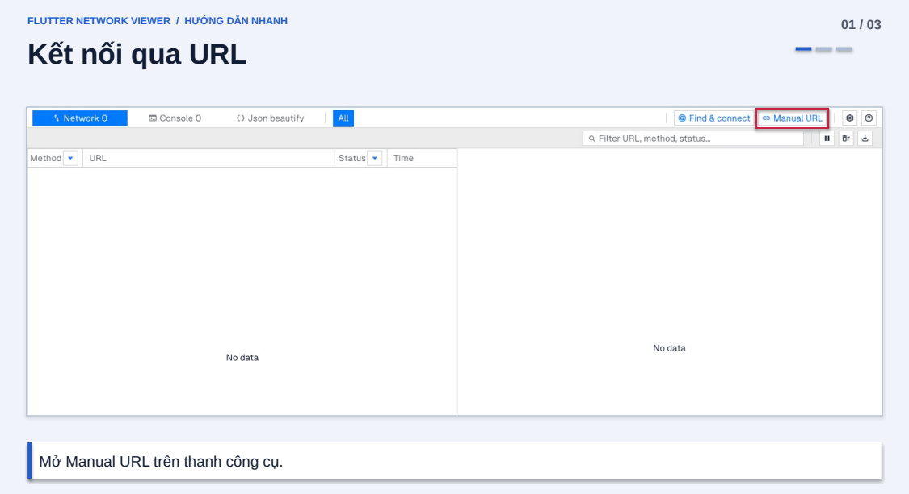

## Network

- Tìm request theo URL, method hoặc status. Dùng nút tam giác ở cột **Method** hoặc **Status** để lọc; chọn **ALL** để bỏ bộ lọc của cột đó.
- Chọn một request để xem **Overview**, **Request header**, **Request body**, **Response header**, **Response body** hoặc **Raw**. Trong **Overview**, method, domain, endpoint và query params hiển thị riêng. Bạn có thể sao chép giá trị từng dòng hoặc sao chép cả request dưới dạng cURL.
- Body dạng JSON có hai chế độ **JSON** và **Tree**. Nếu body là ảnh hoặc ảnh base64 được nhận diện, bạn có thể xem trước, phóng to và chọn **Fit image** để đưa ảnh vừa khung.
- Kéo đường phân cách trên tiêu đề bảng để thay đổi độ rộng cột. Khi chi tiết mở cạnh bảng, kéo đường phân cách giữa hai khung để chỉnh không gian hiển thị.

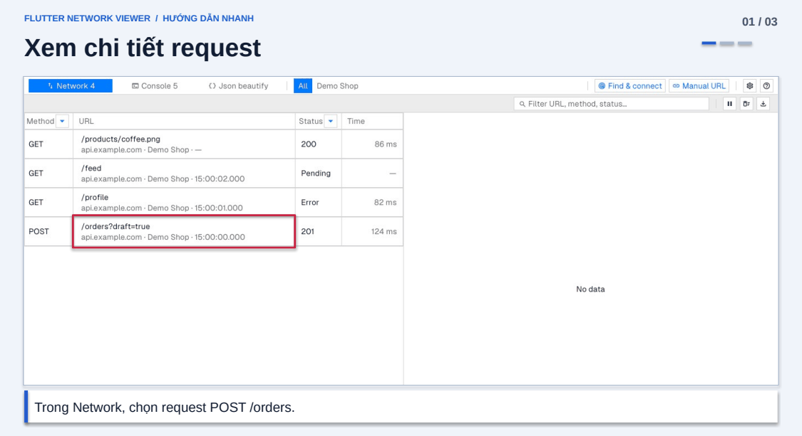

### Xem trước ảnh

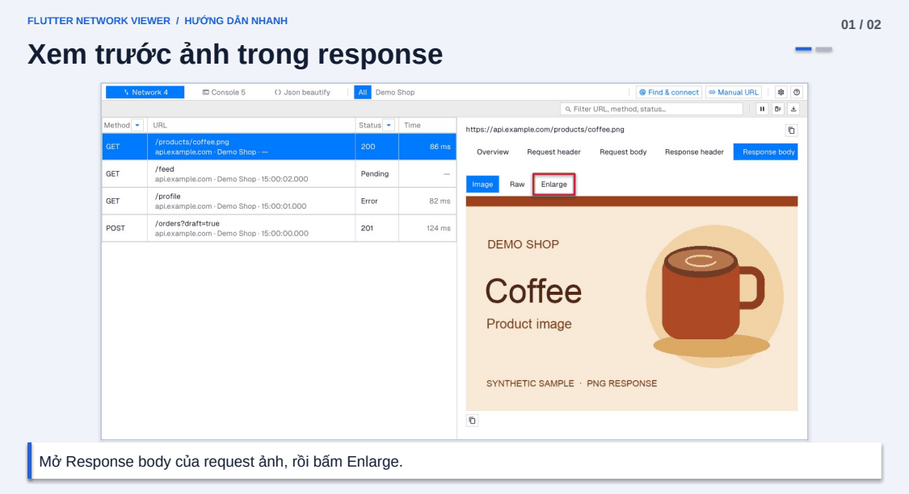

## Console

Console hiển thị log từ `print`, `debugPrint`, stderr và `dart:developer` kể từ khi kết nối. Tìm theo nội dung, logger, lỗi hoặc stack trace; dùng các bộ lọc **Source** và **Level** để thu hẹp kết quả.

Để lọc riêng nội dung **Message**:

1. Bấm nút tam giác ở cột **Message**.
2. Nhập từ khóa và bấm **+** hoặc nhấn **Enter** để thêm tag. Có thể thêm nhiều tag.
3. Bấm **×** trên một thẻ để xóa tag đó. Khi không còn tag, Viewer bỏ điều kiện lọc Message.

Một dòng xuất hiện nếu Message chứa **ít nhất một tag**, không phân biệt chữ hoa/thường, và vẫn đáp ứng các bộ lọc khác đang bật. Message dài tự xuống dòng; kéo đường phân cách trên tiêu đề bảng để điều chỉnh độ rộng cột.

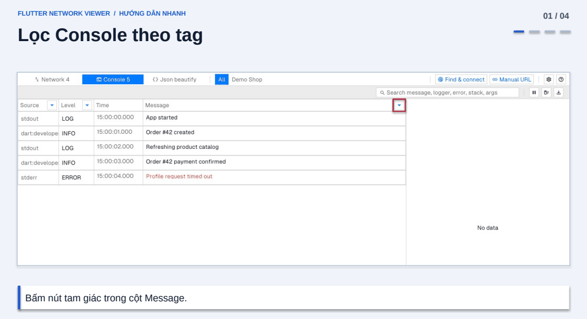

### Xem chi tiết log

Chọn một dòng log để xem thông tin và sao chép từng giá trị trong bảng **Detail**. Sang **Raw** để xem bản ghi ở dạng **JSON** hoặc **Tree**.

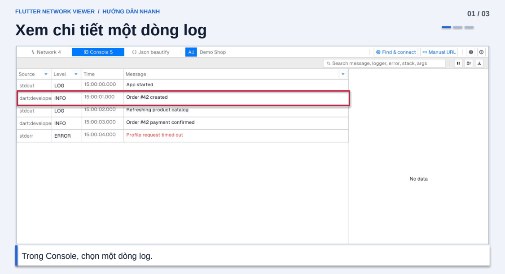

## Json beautify

1. Mở **Json beautify** và dán JSON vào khung bên trái.
2. Bấm **Format** hoặc nhấn **⌘/Ctrl + Enter**.
3. Xem kết quả bên phải dưới dạng **JSON** hoặc **Tree**. Dùng các nút trên thanh công cụ để tìm kiếm, sao chép hoặc tải xuống JSON đã định dạng.

Nếu JSON không hợp lệ, Viewer chỉ vị trí lỗi. Bạn có thể dùng công cụ này ngay cả khi chưa kết nối app Flutter.

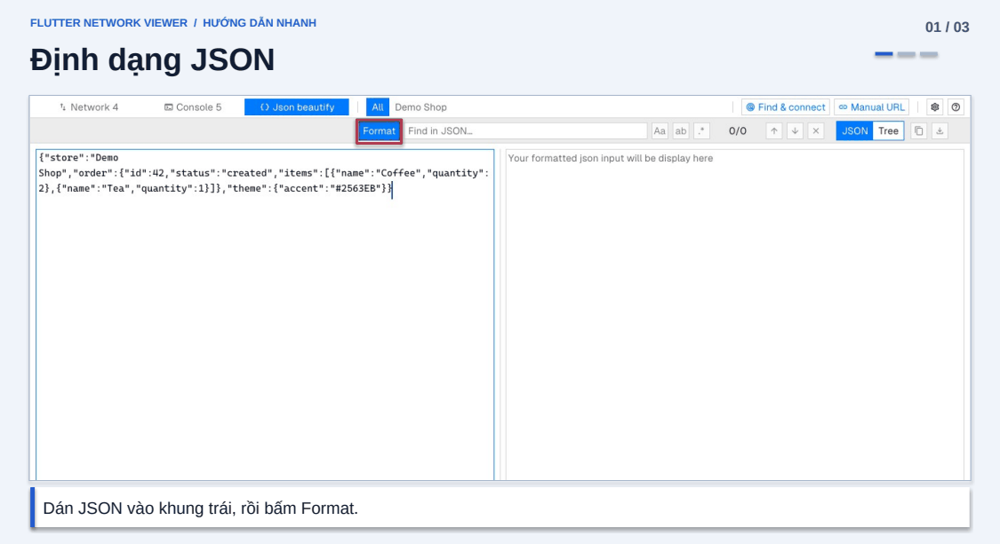

### Tìm trong JSON

Trong trình xem JSON, dùng ô tìm kiếm và hai nút mũi tên để chuyển kết quả. **Aa** bật phân biệt hoa/thường, **ab** tìm nguyên từ, và **`.*`** tìm theo biểu thức chính quy. Bạn cũng có thể dùng **F3** hoặc **Shift + F3** để chuyển tới kết quả tiếp theo hoặc trước đó.

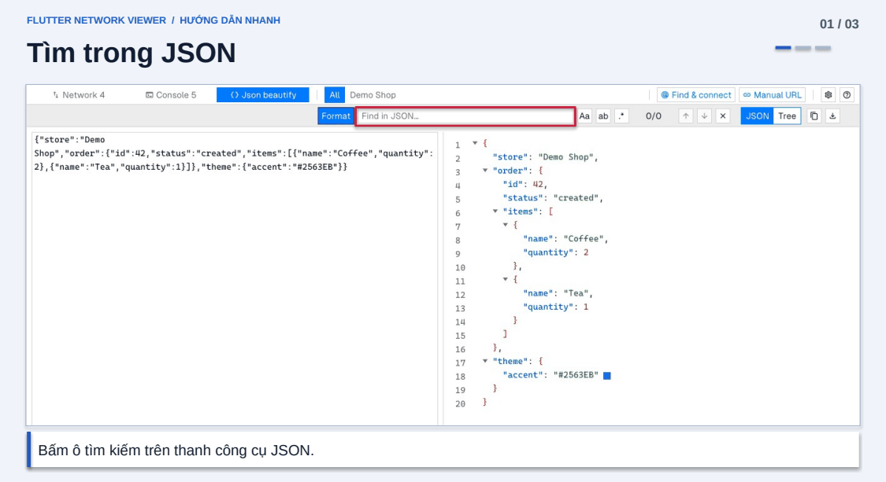

## Tạm dừng, xóa và xuất dữ liệu

| Nút | Tác dụng |
| --- | --- |
| **Pause / Resume** | Tạm dừng hoặc tiếp tục thu thập. Request và log phát sinh trong lúc tạm dừng sẽ không được bổ sung lại. |
| **Clear** | Xóa dữ liệu đang thu thập. Kết nối vẫn hoạt động để nhận request và log mới. |
| **Export** | Lưu dữ liệu đã thu thập thành tệp JSON, kể cả dữ liệu đang bị ẩn bởi bộ lọc. |

Dữ liệu capture chỉ được giữ trong phiên mở Viewer. Hãy xuất trước khi đóng ứng dụng nếu muốn lưu lại. Tệp export có thể chứa URL, headers, body và log của app Flutter; hãy kiểm tra trước khi chia sẻ.

<details>
<summary>Tạm dừng và tiếp tục</summary>

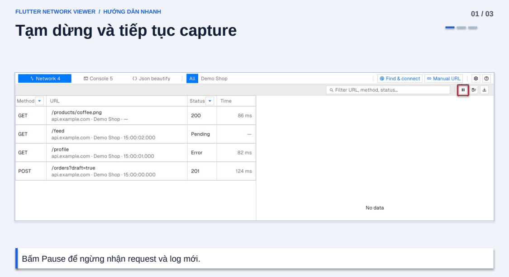

</details>

<details>
<summary>Xuất dữ liệu</summary>

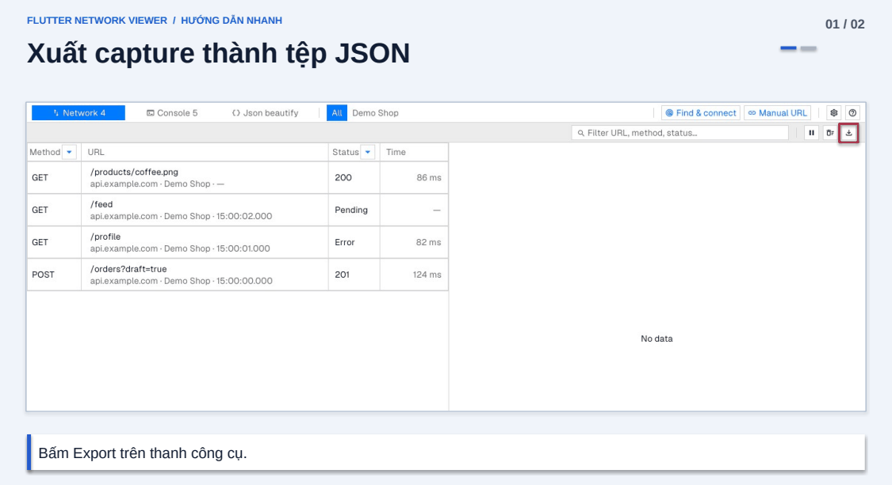

</details>

<details>
<summary>Xóa dữ liệu</summary>

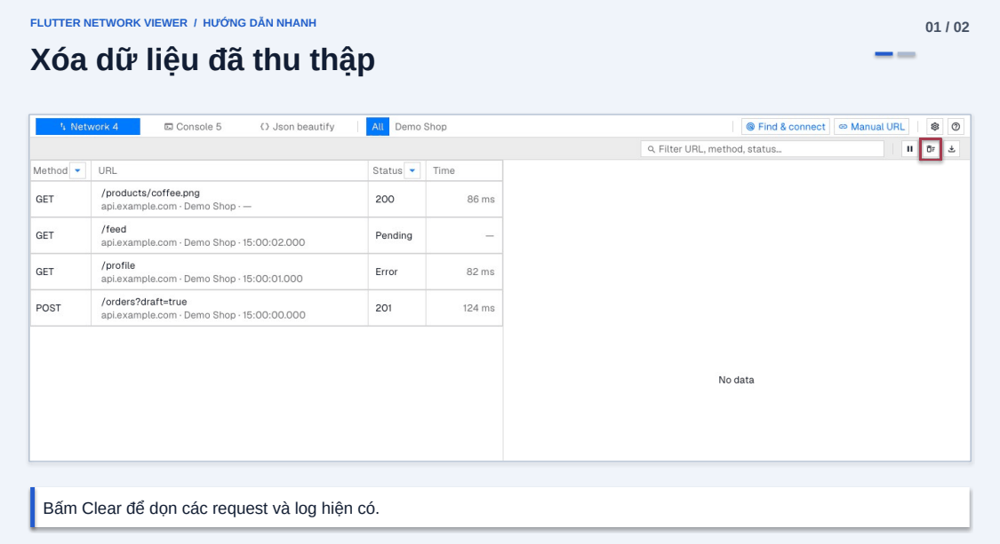

</details>

## Cài đặt và MCP

Bấm biểu tượng bánh răng để đổi **giao diện sáng/tối**, **ngôn ngữ Việt/Anh** hoặc **cỡ chữ**. Cỡ chữ mặc định là 14 pt; dùng nút **−** và **+** để thay đổi.

Để đọc capture bằng Codex hoặc Claude trên cùng máy:

1. Mở **Settings → MCP** và bật công tắc.
2. Bấm **Copy manual MCP for Codex** hoặc **Copy manual MCP for Claude**.
3. Dùng cấu hình vừa sao chép để thêm Viewer vào công cụ tương ứng. Giữ Viewer mở trong lúc sử dụng.

MCP chỉ đọc dữ liệu và chỉ mở trên máy cục bộ. Endpoint mặc định là `http://127.0.0.1:38943/mcp`. Nếu đổi cổng, nhấn **Enter** để lưu rồi sao chép lại cấu hình.

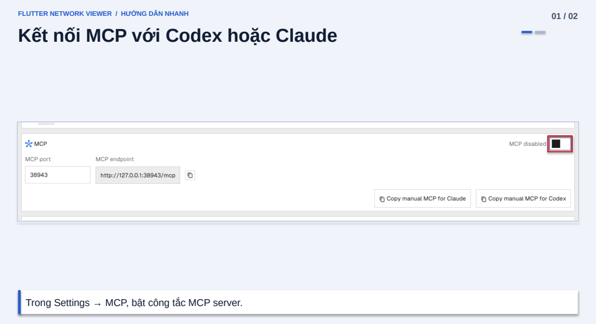

Nếu bản xem trước chưa nhận được cập nhật trong **Settings**, kiểm tra [GitHub Releases](https://github.com/DevMobileAn27/flutter_network_viewer/releases) hoặc tải artifact mới theo hướng dẫn cài đặt ở trên.

## Khi chưa thấy request hoặc log

- Kiểm tra app đã kết nối, Viewer không ở trạng thái **Pause**, và đang chọn đúng app hoặc **All**.
- Xóa từ khóa tìm kiếm và kiểm tra lại các bộ lọc, kể cả tag ở cột **Message**.
- Thử tạo request hoặc log mới sau khi kết nối. Kiểm tra lại VM Service URL nếu vừa chạy lại app.
- HTTP qua `dart:io`, gồm adapter mặc định của Dio và `package:http`, có thể xuất hiện trong Network. Bản release, Flutter Web, request từ WebView, thư viện HTTP native và frame WebSocket nằm ngoài phạm vi theo dõi này.

Cần trợ giúp? Đặt câu hỏi tại [GitHub Discussions](https://github.com/DevMobileAn27/flutter_network_viewer/discussions). Nếu cần gửi log chẩn đoán kết nối, tìm tệp `viewer.log` trong `~/Library/Logs/Flutter Network Viewer/` trên macOS hoặc `%LOCALAPPDATA%\Flutter Network Viewer\` trên Windows.

## Chạy từ mã nguồn

Cài **Rust stable** và **Python 3.11+**. Trên macOS cần Xcode Command Line Tools; trên Windows cần Visual Studio Build Tools với **Desktop development with C++** và Windows SDK. Viewer không cần Flutter SDK để build; bạn chỉ cần Flutter SDK để chạy app Flutter muốn theo dõi.

Trong thư mục repository, chạy:

```sh
cargo run --locked
```

Xem [hướng dẫn đóng gói và phát hành](docs/release.md) hoặc [ma trận tính năng và kiểm thử](docs/feature-matrix.md) nếu bạn muốn đóng góp. Dự án dùng giấy phép [GPL-3.0](LICENSE).
