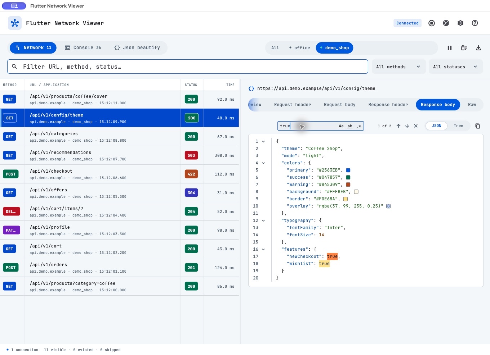
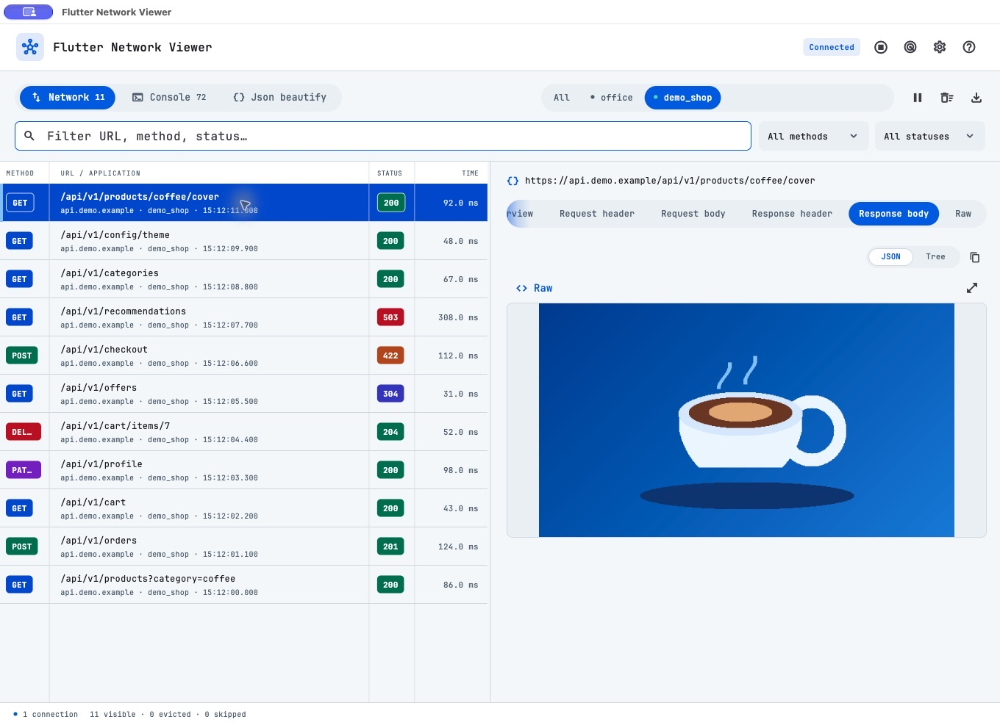
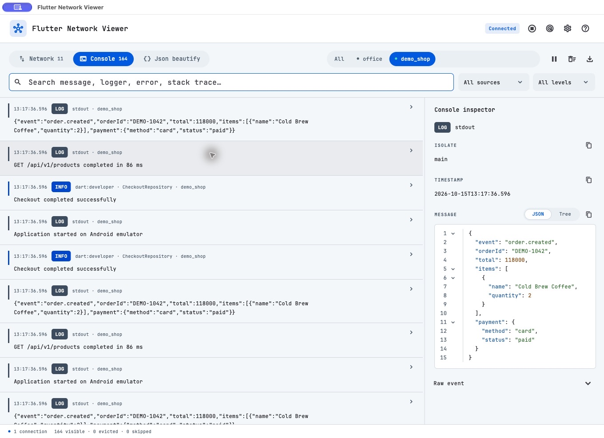
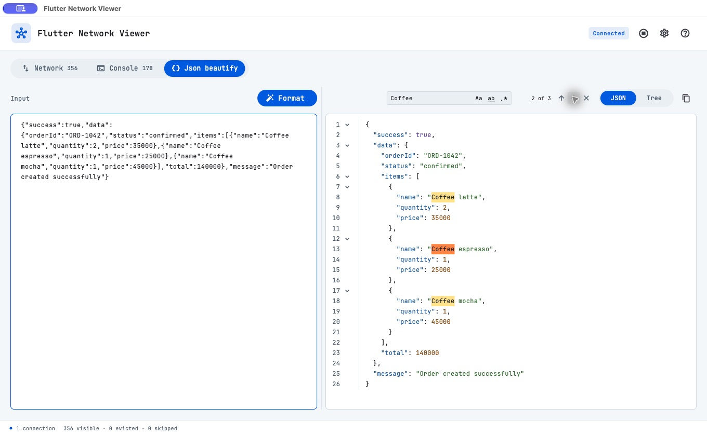
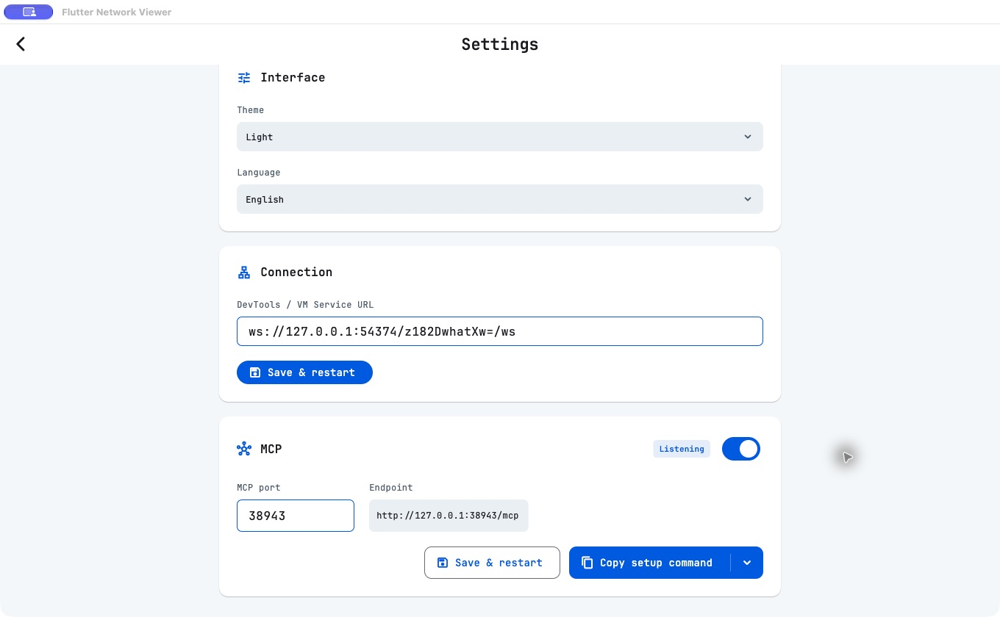

# Flutter Network Viewer

Ứng dụng desktop dành cho macOS và Windows, giúp xem API request/response, đọc log Flutter và định dạng JSON trong cùng một cửa sổ. Không cần thêm thư viện vào ứng dụng đang theo dõi.

Tự tìm project Flutter đang chạy, tìm kiếm trong JSON, xem nhanh màu và ảnh base64. App ghi nhớ cách chia các khung, độ rộng cột và tab chi tiết bạn đang dùng.



Các ảnh trong hướng dẫn sử dụng dữ liệu demo.

## Cài đặt

Tải bản phù hợp từ [GitHub Releases](https://github.com/DevMobileAn27/flutter_network_viewer/releases):

- **macOS chip M:** chọn bản `macos-arm64.zip`.
- **macOS Intel:** chọn bản `macos-x86_64.zip`.
- **Windows x64:** chọn bản `windows-x64-setup.exe`, hoặc ZIP nếu muốn dùng bản portable.

Trên macOS, giải nén và kéo **Flutter Network Viewer.app** vào **Applications**. Nếu macOS báo nhà phát triển chưa được xác minh hoặc ứng dụng bị hỏng, mở **Terminal** và chạy:

```sh
xattr -dr com.apple.quarantine "/Applications/Flutter Network Viewer.app"
open "/Applications/Flutter Network Viewer.app"
```

Chỉ dùng các lệnh này với bản tải xuống đáng tin cậy từ GitHub Releases chính thức của repository.

Trên Windows, chạy installer. Với bản portable, giải nén rồi mở **flutter_network_viewer.exe**, giữ nguyên các DLL và thư mục `data` đi kèm.

## Kết nối ứng dụng Flutter

1. Chạy ứng dụng cần theo dõi ở chế độ **debug** hoặc **profile**.
2. Mở Flutter Network Viewer. App tự tìm và kết nối khi có một ứng dụng Flutter đang chạy trên cùng máy tính.
3. Nếu có nhiều ứng dụng, chọn tên project trong danh sách xuất hiện phía trên. Có thể bấm biểu tượng **radar** để tìm lại.
4. Đợi trạng thái **Connected**, rồi thao tác trên ứng dụng Flutter để phát sinh request và log.

Khi chạy lại project và URL thay đổi, Viewer tự tìm lại project đã chọn. Có thể bật/tắt tại **Settings → Connection → Automatically detect Flutter apps**. Nút **Stop** dừng cả việc tự tìm và kết nối lại.

Tự tìm hỗ trợ ứng dụng chạy trên cùng máy, bao gồm Android emulator. Nếu không tìm thấy project hoặc cần kết nối thủ công, bấm **Connect an app** khi danh sách trống, dán **Flutter DevTools URL** hoặc **Dart VM Service URL** từ terminal, rồi bấm **Connect an app**. Cũng có thể nhập URL tại **Settings → Connection → Save & restart**; thao tác này chuyển sang kết nối thủ công.

Bấm **?** trên thanh đầu trang để mở hướng dẫn sử dụng cơ bản. Nút **Go to Discussion** mở [GitHub Discussions](https://github.com/DevMobileAn27/flutter_network_viewer/discussions) để đặt câu hỏi, góp ý hoặc báo vấn đề.

## Network

- Tìm request theo URL, method hoặc status; kết hợp bộ lọc method và trạng thái.
- Kéo divider giữa các cột **Method**, **URL / Application**, **Status** và **Time** để đổi độ rộng. Method và Status mặc định gọn ở chiều rộng tối thiểu. App ghi nhớ khi chuyển tab và mở lại; bảng có thể cuộn ngang nếu khung hiển thị quá hẹp.
- Chọn một request để xem **Overview**, **Request header**, **Request body**, **Response header**, **Response body** và **Raw**.
- Với body JSON, chuyển giữa **JSON** và **Tree**, thu gọn các nhánh hoặc sao chép nội dung.
- Chuỗi màu có ô preview bên cạnh, trong cả **JSON** và **Tree**. Hỗ trợ mã HEX như `#B45309`, `rgb/rgba`, `hsl/hsla`, màu Flutter dạng `0xAARRGGBB` và một số tên màu thông dụng. Copy vẫn giữ nguyên dữ liệu gốc.
- Danh sách và chi tiết mặc định chia đôi cửa sổ. Kéo divider để đổi độ rộng; nhấp đúp để đưa về giữa. App ghi nhớ vị trí đã kéo và giữ tab chi tiết khi chuyển request hoặc mở lại.
- Khi các tab chi tiết không đủ chỗ, cuộn ngang để xem thêm; gradient xanh ở hai đầu cho biết phía còn tab bị ẩn.

Nếu có nhiều ứng dụng, chọn tab tên ứng dụng để xem riêng hoặc **All** để xem tất cả.

### Xem ảnh trong body

Chọn **Response body** để xem ảnh đã thu thập. App tự nhận diện ảnh base64, kể cả khi response thiếu thông tin kiểu ảnh. Hỗ trợ cả data URI và chuỗi base64 được bọc trong JSON.

- Bấm ảnh hoặc biểu tượng **phóng to** để mở cửa sổ xem ảnh.
- Dùng nút **Zoom in / Zoom out**, cuộn hoặc kéo để xem; **Fit image** đưa về khung mặc định.
- Chọn **Raw** để đọc hoặc copy chuỗi gốc, rồi chuyển lại **Image preview** khi cần.
- Body không phải ảnh hoặc không giải mã được vẫn có thể đọc ở dạng văn bản/Raw.



## Console

Xem log từ `print/debugPrint`, lỗi stderr và `dart:developer`. Tìm theo nội dung, logger, lỗi hoặc stack trace; lọc theo nguồn và mức độ log.

Chọn một dòng để xem chi tiết. Log JSON có thể xem ở dạng **JSON / Tree**; các khối JSON hoặc lỗi Flutter được ghép lại khi nhận diện được. Có thể copy nội dung và kéo divider để điều chỉnh phần danh sách/chi tiết; vị trí được ghi nhớ riêng với Network.



## Json beautify

1. Mở tab **Json beautify** và dán JSON vào khung bên trái.
2. Bấm **Format** hoặc **⌘/Ctrl + Enter**.
3. Xem kết quả ở dạng **JSON** hoặc **Tree**, tìm kiếm, xem preview màu và sao chép kết quả.

Nếu JSON không hợp lệ, app hiển thị dòng và cột có lỗi. Kéo divider để thay đổi độ rộng hai khung; vị trí này được ghi nhớ. Công cụ dùng được ngay cả khi chưa kết nối ứng dụng.



### Tìm trong JSON

Thanh tìm kiếm có trong **Request body**, **Response body** khi nội dung là JSON, và trong kết quả **Json beautify**.

| Thao tác | Cách dùng |
| --- | --- |
| Mở ô tìm kiếm | **⌘/Ctrl + F** trong khu vực JSON |
| Phân biệt chữ hoa/thường | Bật **Aa** |
| Tìm nguyên từ | Bật **ab** |
| Tìm bằng biểu thức chính quy | Bật **.\*** |
| Kết quả tiếp theo / trước đó | Mũi tên xuống / lên, hoặc **Enter / Shift + Enter** khi đang nhập tìm kiếm |
| Xóa tìm kiếm | Nút **×** |

Kết quả được tô sáng trong nội dung. **2 of 3** nghĩa là đang ở kết quả thứ 2 trong 3 kết quả; **No results** nghĩa là chưa có kết quả để hiển thị. Nội dung tìm kiếm được giữ khi đổi giữa JSON và Tree.

## Tạm dừng, xóa và xuất dữ liệu

- **Pause / Resume**: tạm dừng hoặc tiếp tục nhận dữ liệu. Request và log phát sinh trong lúc tạm dừng sẽ không được bổ sung lại.
- **Clear**: xóa request và log đang lưu trong Viewer.
- **Export**: lưu toàn bộ dữ liệu đã thu thập thành file JSON, bao gồm cả mục đang bị ẩn bởi bộ lọc.

Dữ liệu chỉ được giữ trong phiên mở app; hãy xuất trước khi đóng nếu cần lưu lại. Khi đạt giới hạn lưu trữ, các mục cũ nhất được loại bỏ.

## Cài đặt và MCP

Bấm biểu tượng **bánh răng** để đổi giao diện sáng/tối, ngôn ngữ Việt/Anh hoặc URL kết nối. Các lựa chọn được ghi nhớ cho lần mở sau.

Để dùng dữ liệu trong công cụ AI có hỗ trợ MCP:

1. Vào **Settings → MCP** và bật công tắc.
2. Bấm **Copy setup command**, sau đó dán vào công cụ AI để thiết lập kết nối.
3. Nếu cần cấu hình thủ công, bấm mũi tên bên cạnh nút copy để chọn cấu hình JSON hoặc Codex.
4. Giữ Viewer mở và chạy công cụ AI trên cùng máy tính.

Cổng mặc định là **38943**. Nếu đổi cổng, bấm **Save & restart** rồi sao chép lại cấu hình. MCP cho phép AI đọc danh sách ứng dụng, request, chi tiết request, log và thống kê dữ liệu đang có.



## Cập nhật ứng dụng

App kiểm tra phiên bản mới khi mở. Bạn cũng có thể vào **Settings → App updates → Check for updates** để kiểm tra thủ công. Khi có bản mới, xác nhận trong cửa sổ cập nhật để tải và cài đặt; app sẽ đóng rồi mở lại. Hãy xuất capture cần giữ trước khi cập nhật.

Bản **0.1.0** cần tải và cài thủ công bản có updater một lần. Trên macOS, kéo app vào **Applications**. Trên Windows, nên dùng file `windows-x64-setup.exe`.

## Khi chưa thấy request hoặc log

- Kiểm tra trạng thái **Connected**, URL mới nhất và nút **Pause**.
- Thử thao tác gọi API hoặc ghi log mới sau khi kết nối; console không có log của thời điểm trước đó.
- Chạy ứng dụng Flutter ở **debug/profile**. Không hỗ trợ theo dõi app release hoặc Flutter Web.
- Hỗ trợ HTTP thông thường của Flutter, bao gồm cấu hình mặc định của Dio và package:http. Request từ WebView, thư viện HTTP native và dữ liệu WebSocket không xuất hiện trong danh sách này.
- Xóa nội dung tìm kiếm, đưa bộ lọc về **All** và kiểm tra tab ứng dụng đang chọn.

## Chạy từ mã nguồn

Cần Flutter **3.41 / Dart 3.11** trở lên. Trên macOS cần Xcode và CocoaPods; trên Windows cần Visual Studio với **Desktop development with C++**.

```sh
flutter pub get
flutter run -d macos
```

Trên Windows, thay lệnh cuối bằng `flutter run -d windows`.

Để tạo bản ứng dụng:

```sh
# macOS
bash tool/build_macos.sh

# Windows (chạy trên Windows)
flutter build windows --release
```

Bản macOS nằm tại `build/macos/Build/Products/Release/Flutter Network Viewer.app`. Bản Windows nằm trong `build/windows/x64/runner/Release/`; giữ nguyên các file đi kèm khi sao chép ứng dụng.
## Phát hành bản mới

GitHub Actions kiểm tra format, analyze và test cho pull request. Khi tăng version và build number trong `pubspec.yaml`, điền `github_release_info.md` rồi push lên `main`, workflow build macOS chip M, macOS Intel và Windows x64, tạo draft release kèm ZIP, installer Windows, feed cập nhật đã ký và checksum. Bạn kiểm tra draft trước khi publish.

Xem [hướng dẫn phát hành](docs/releasing.md) và [cấu hình khóa ký cập nhật](docs/app-updates.md). Cần cấu hình hai Actions secrets trước lần release đầu tiên.
